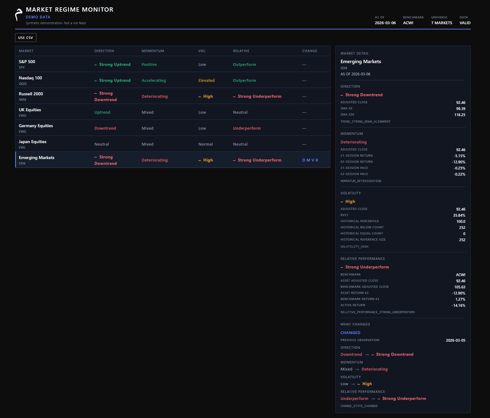
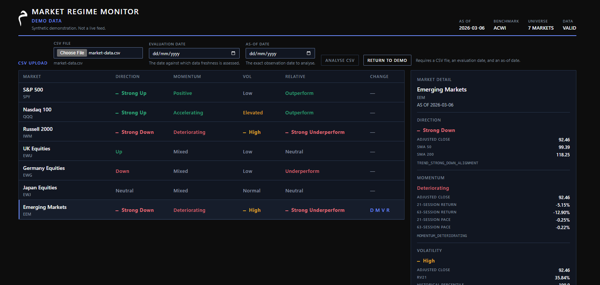

# Market Regime Monitor

A deterministic market-state analytics application. It reduces major equity markets to four transparent dimensions — Direction, Momentum, realised Volatility, and ACWI-relative Performance — and shows what changed since the previous observation.



The same validated input always produces the same result. Disagreements between the four dimensions are preserved. There is no fifth, composite regime. The name uses regime for that visible four-part state, not for a single hidden score.

## Live demonstration

A gated interactive demonstration is available for institutional evaluation.

[**Request Demo Access**](https://ca-market-regime-monitor-demo.wittysea-10c48c15.uksouth.azurecontainerapps.io)

Access is email-verified. The hosted demonstration uses the same analytical application described in this repository; it remains analytical research software and does not provide investment recommendations, trade signals, or price predictions.

## What it does

Market Regime Monitor reads one price panel and classifies each enabled market at one explicit as-of date. The board is the first view. The detail panel explains the selected market with the measurement, the state label, the reason code, and the categorical change.

It is analytical research software. It does not recommend a trade, predict a price, or place an order.

## Market State Board

The board is one table with six columns:

```text
MARKET | DIRECTION | MOMENTUM | VOL | RELATIVE | CHANGE
```

Each row is a market. Colour and the glyphs D, M, V, and R repeat the words. They are not a separate score. Selecting a row opens the detail panel. The board stays the primary view.

The V1 universe is SPY, QQQ, IWM, EWU, EWG, EWJ, and EEM. ACWI is the common comparison benchmark. It is required for the calculation and is not a board row.

## The four dimensions

| Dimension | What it measures |
| --- | --- |
| Direction | SMA-based trend classification using adjusted close, SMA50 and SMA200. It is not a swing-high/swing-low trend model. The screen shows Strong Uptrend, Uptrend, Neutral, Downtrend, and Strong Downtrend. The API still returns Strong Up, Up, Neutral, Down, and Strong Down. |
| Momentum | Whether the 21-observation and 63-observation price pace agree, conflict, or are deteriorating. |
| Volatility | 21-return annualised realised volatility, placed in a regime by its percentile against that market's own prior 252 readings. |
| Relative Performance | The 63-observation active return of the market minus the ACWI return over the same observations. |

Lookbacks count trading observations in the supplied panel. They are not calendar-day windows. The methodology, thresholds, and reason codes are in `FINANCE_SPEC.md`. Acceptance cases are in `GOLDEN_CASES.md`.

A market can be strong on one dimension and weak on another. The application does not collapse those readings into one label.

## What Changed

What Changed compares the four categorical states with the immediately previous valid observation in the panel. A numerical move that stays inside the same state is not a change. The board stays quiet unless a label actually changes. The four possible dimensions, in order, are direction, momentum, volatility, and relative performance.

Direction transitions use the public labels. Up to Strong Up is shown as Uptrend → Strong Uptrend. Momentum, Volatility, and Relative Performance keep their existing labels.

If the panel is long enough for the current state but not for the previous complete snapshot, the status is unavailable. That is a result, not a failed request.

## Demo and CSV upload

V1 has two sources.

The bundled demo is deterministic synthetic weekday data. It is not a live feed and it is not historical vendor data. The interface labels it DEMO DATA.

A user may instead analyse a CSV. The interface labels a successful upload UPLOADED CSV. The API records `data_source: "upload"`. `data_label` is null for an upload. The file is read for that request only. It is not saved.

Opening the CSV form does not replace the current board. Return to Demo restores the bundled panel and discards the upload request. If an older response arrives after a newer one, only the newer analysis is shown.



## Architecture

```text
React + TypeScript + Vite
        |
        v
FastAPI
        |
        v
Python market_state core
        |
        +-- Trend
        +-- Momentum
        +-- Volatility
        +-- Relative Performance
        +-- What Changed
```

The browser displays results. It does not calculate them. The FastAPI adapter checks the request boundary, calls the Python core, and maps known errors to a small JSON envelope. Formulas stay in `src/market_state/`.

## Validation philosophy

Invalid input fails closed. The parser does not trim identifiers, fill gaps, interpolate prices, repair malformed rows, or drop rows to make a file succeed. Dates are explicit. The as-of date and the evaluation date are request inputs. The application does not read the system clock.

Client-side checks, such as the file-size notice, are there for the person using the form. The server is the trust boundary: a bounded read, strict UTF-8, rejection of NUL bytes, and the same finance validation used by the tests.

## Tech stack

- Python 3.11 or newer, verified on 3.14. The package requires pandas.
- FastAPI, served locally with uvicorn.
- React 19, TypeScript, and Vite 8. The frontend toolchain is Node.js 24.
- The MEEM Toolkit Design System v1.0. Tokens are generated into CSS and checked in.

## Testing

The V1.0.0 suite, run locally:

- 327 Python tests passed, including finance unit and regression tests, deterministic golden fixtures, look-ahead checks, market isolation, and API contract tests.
- The original 309 finance and monitoring tests still pass. Four further tests reject a manually assembled snapshot whose nested identity contradicts the snapshot.
- 28 frontend behaviour tests passed, covering the board, the detail panel, public Direction labels, CSV analysis, Return to Demo, stale-response handling, and focus after a mode change.
- `python -m pip check` reported no broken requirements.
- `npm audit --audit-level=high` and `npm audit --omit=dev --audit-level=high` reported no vulnerabilities.

These tests are the project's own checks. They are not an independent regulatory validation.

## Local setup

Python 3.11+ and Node.js 24 are required. Docker is not used.

From the repository root, on Windows:

```text
python -m venv .venv
.venv\Scripts\activate
python -m pip install -e ".[dev,ui]"
python -m uvicorn app.api.main:app --host 127.0.0.1 --port 8000
```

On macOS or Linux, activate the virtual environment with `source .venv/bin/activate` and use the same `python` commands.

In another shell:

```text
cd frontend
npm ci
npm run dev
```

Open the Vite address, normally `http://127.0.0.1:5173`. The development server proxies `/api` to the API on port 8000. Start the API before the page, or the first demo request will fail until the API is up.

Tests and the production frontend build:

```text
python -m pytest -q
cd frontend
npm test
npm run typecheck
npm run build
```

`npm test`, `npm run typecheck`, and `npm run build` regenerate the design tokens first. The generated file must match the committed copy.

## Input CSV contract

The required columns are exactly:

```text
date,market_id,adjusted_close
```

`date` is `YYYY-MM-DD`. `market_id` must match the configured universe, including ACWI when a market's relative performance is calculated. `adjusted_close` is the only price field. The panel needs enough history for the requested calculation: 274 observations for a current snapshot, and 275 for a complete What Changed comparison.

There is no silent filling, interpolation, identifier repair, or malformed-row repair. A file that does not meet the contract returns an error with a stable code. See `FINANCE_SPEC.md` for the methodology behind a valid panel.

## Limitations

V1 does not include charts, live or vendor market data, real-time prices, a database, accounts, saved uploads, backtesting, trading signals, expected returns, recommendations, position sizing, or portfolio construction.

The bundled demo is synthetic. A CSV result describes only the file that was submitted.

## Scope

Market Regime Monitor is analytical research software. It is not investment advice. It does not recommend buying or selling. It does not trade, and it does not claim to predict prices.

## Repository structure

```text
app/api/                 FastAPI adapter
app/demo/                synthetic weekday demonstration panel
frontend/                React application
src/market_state/        finance and monitoring core
tests/                   Python tests
docs/images/             public screenshots
FINANCE_SPEC.md          methodology
GOLDEN_CASES.md          acceptance cases
MEEM_DESIGN_SYSTEM.md    visual system
```

## Branding

The interface uses MEEM Technologies branding. MEEM Technologies branding and marks are proprietary to their owner.

MEEM Technologies is a UK-based investment-technology engineering company building transparent, auditable software for international capital-markets workflows.

Source code in this repository is licensed under the Apache License 2.0. See `LICENSE`. That licence does not grant a right to use the MEEM Technologies name, mark, logos, or other brand assets. Screenshots and documentation that contain the mark do not independently licence the mark. See `BRANDING.md`.
